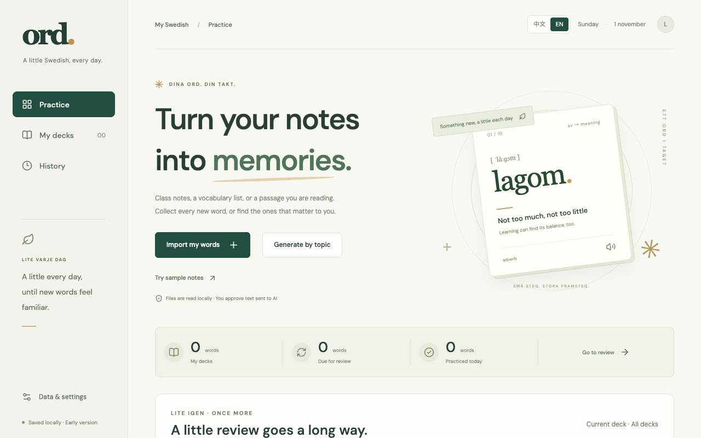
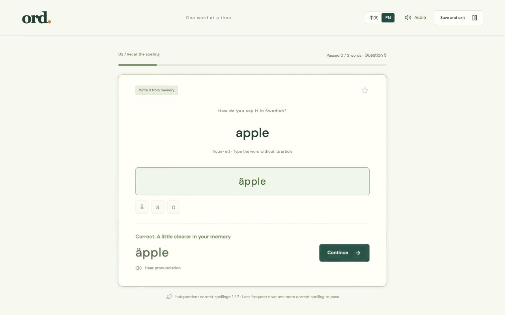

# ord.

Swedish vocabulary practice from your own notes, reading material, or a topic you want to learn.

[Try ord.](https://ord-swedish-practice.onrender.com/) · [简体中文](README.zh-CN.md) · [Demo video](docs/media/ord-demo.mp4)



## How it works

Import a word list or reading passage, review the extracted words, and save them as a deck. You can also give AI a topic and choose an SFI course level (A–D) to generate a word list.

Practice starts with meaning recognition, then moves to spelling. Each group contains up to ten words. Words you struggle with appear more often; after two correct spellings without hints, a word leaves the round. The round ends when every word passes. Return to the home page for due reviews or another round of practice.



## Features

- Import TXT, Markdown, CSV, XLSX, DOCX, text-based PDF, or pasted text.
- Use AI to organize messy notes or pick vocabulary from a passage. A local parser handles separated word lists without an API key.
- Review and edit words before saving, with source text and AI additions marked.
- Name and rename decks, search words, and keep your place between sessions.
- Hear Swedish pronunciation and typing and answer sounds, with separate audio controls.
- Switch between English and Chinese interfaces.
- Export JSON backups or CSV word lists; merge a backup into an existing collection.

## Use your own API

The website is open without a login. AI extraction and topic generation require your own API key; importing a separated list and practicing do not.

Open **Data & settings → Personal AI settings**, or **Use your own API / AI settings** in the import window. Choose OpenAI or a custom OpenAI-compatible provider, enter the Base URL, model, API format, and key, then select **Use this API on this page**.

Both Responses API and Chat Completions are supported. Custom models must support JSON Schema structured output, and custom endpoints must use a public HTTPS domain on port 443.

Your provider charges your account for AI requests. The key stays in page memory and clears on reload. Requests pass through the app's backend to your chosen provider; keys are not saved in browser storage or backups, or logged by the application. See [API setup and deployment](docs/public-byok.md) for details.

## Your data

Decks and progress are saved in your browser, with no account or cross-device sync. A different browser, device, or website address has separate data. Export a JSON backup before clearing browser data, and use **Merge a backup** to move your collection.

Files are read locally. AI receives the material or topic only after you consent. If you enable “skip known words,” practiced terms are also sent. The interface loads fonts from Google Fonts; pronunciation uses your device's speech service.

## Run locally

Requires Node.js 24+ and npm.

```sh
npm ci
npm run dev -- --port 5173
```

Open [localhost:5173](http://127.0.0.1:5173/). Configure AI through the same settings used on the hosted website.

```sh
npm test           # Unit tests
npm run build      # Type check and build the client and Node server
npm start          # Serve the build at localhost:5173
npm run test:e2e   # Browser tests; requires Chrome and the dev server
```

The app uses React, TypeScript, Vite, and IndexedDB, with a Node.js backend for AI requests. Node.js and Docker deployment instructions are in the [deployment guide](docs/独立网站部署.md).

## Limitations

- AI-generated meanings and examples need checking. SFI levels guide difficulty; generated lists are not official SFI word lists.
- Scanned PDFs, images, handwriting, and legacy `.doc` files are not supported. Files are limited to 10 MB, PDFs to 80 pages, and AI input to 30,000 characters per request.
- Local parsing works best with Swedish–Chinese notes. English meanings should use clear separators or table columns. Switching the interface language does not translate deck content.
- Review intervals use fixed rules. Completing a round records spelling practice, not long-term retention.
- Pronunciation requires a Swedish voice on the device and browser permission to play audio. Browser tests use Chrome; other browsers and physical phones need further testing.

## Feedback

Found a bug or have a suggestion? [Open an issue](https://github.com/leoohuang/swedish-vocab-trainer/issues). Include the steps to reproduce it and your browser version. Use a small sample rather than personal study material, and never include an API key.

No license has been selected for this repository.
