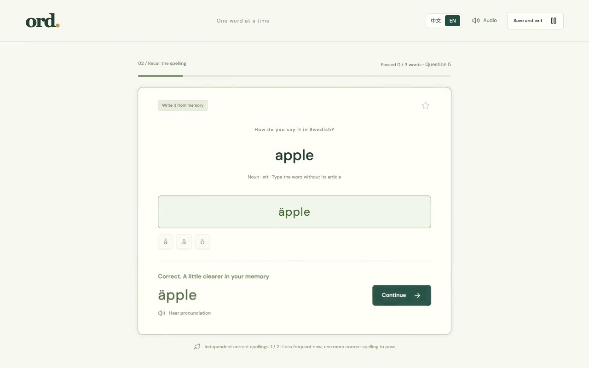

# ord. · 瑞典语单词练习

把自己的笔记、课文，或想学的主题，变成瑞典语单词练习。

[在线使用](https://ord-swedish-practice.onrender.com/) · [English](README.md) · [演示视频](docs/media/ord-demo.mp4)


## 怎么用

上传单词合集或课文，核对整理出的词条，再保存为词库。没有现成材料也可以输入主题，选择 SFI A–D 课程等级，让 AI 生成一份词表。

练习先从词义选择开始，再进入拼写。每组最多十个词，没拼对的词会更频繁地出现；不借助提示独立拼对两次后，该词退出本轮。所有词都过关，才算完成。之后可以在首页复习到期单词，或主动再练一遍。



## 功能

- 导入 TXT、Markdown、CSV、XLSX、DOCX、文字型 PDF，也可以直接粘贴文本。
- 用 AI 整理格式不统一的笔记，或从课文中挑选生词；格式清晰的单词列表可用本机规则整理，无需 API。
- 保存前核对、编辑词条，查看原文和 AI 补充内容。
- 自定义词库名称、重命名、搜索单词，保留上次的词库选择和练习进度。
- 瑞典语朗读、键盘声和答题音效，可分别开关。
- 中英文界面切换。
- JSON 完整备份、CSV 词表导出，以及备份合并导入。

## 使用自己的 API

网站无需登录。AI 整理和主题词表生成需要填写自己的 API 密钥；本机规则导入和单词练习不需要。

打开 **数据与设置 → AI 服务**，选择 OpenAI、Anthropic 或自定义接口，填写 API Key，点击 **保存 AI 设置**。OpenAI 和 Anthropic 已预设连接参数；自定义地址和模型调整放在 **高级设置** 中。导入窗口也提供设置入口，已粘贴的材料会保留。

支持 OpenAI Responses、Chat Completions 和 Anthropic Messages。自定义模型需要支持 JSON Schema 结构化输出，接口地址需要使用公开 HTTPS 域名及 443 端口。

AI 费用由所选服务商从你的账户扣取。开启 **记住此设备** 后，密钥保存在当前浏览器，供下次使用；关闭则只在本页生效，也可以随时点击 **清除密钥**。请求会经过本站后端转发给所选服务商；密钥不进入词库备份，服务器不保存或记录密钥。请只在信任的个人设备上记住密钥。详细配置见 [API 设置与部署说明](docs/public-byok.md)。

## 数据保存

词库和学习进度保存在当前浏览器中，没有账号或跨设备同步。换浏览器、设备或网址，会使用各自独立的数据。清理浏览器数据前请导出 JSON 备份；迁移词库时可使用 **合并导入备份**。

文件在本机读取，AI 操作按钮旁会说明发送内容，点击整理或生成后才会发送本次材料或主题。开启“跳过已学词”时，还会发送已练习的词条。界面使用 Google Fonts，朗读使用设备的语音服务。

## 本地运行

需要 Node.js 24 或更高版本，以及 npm。

```sh
npm ci
npm run dev -- --port 5173
```

打开 [localhost:5173](http://127.0.0.1:5173/)。AI 配置方式与在线版本相同。

```sh
npm test           # 单元测试
npm run build      # 类型检查，构建前端和 Node.js 服务
npm start          # 在 localhost:5173 运行构建结果
npm run test:e2e   # 浏览器测试；需安装 Chrome 并启动开发服务
```

项目使用 React、TypeScript、Vite 和 IndexedDB，由 Node.js 后端转发 AI 请求。自行部署可参考 [部署指南](docs/独立网站部署.md)，支持 Node.js 和 Docker。

## 使用限制

- AI 生成的释义和例句需要核对。SFI 等级用于指导难度，生成结果不是官方 SFI 词表。
- 不支持扫描版 PDF、图片、手写内容和旧版 `.doc`。文件上限 10 MB，PDF 上限 80 页，AI 每次接收最多 30,000 字符。
- 本机规则主要适配瑞典语与中文笔记；英文释义建议使用明确分隔符或双列表格。切换界面语言不会翻译词库内容。
- 复习间隔采用固定规则；完成一轮表示完成了拼写练习，不代表已经长期记住。
- 朗读依赖设备上的瑞典语语音及浏览器的音频播放权限。浏览器测试使用 Chrome，其他浏览器和实体手机仍需进一步测试。

## 问题反馈

发现问题或有功能建议，可以 [提交 Issue](https://github.com/leoohuang/swedish-vocab-trainer/issues)。请附上复现步骤和浏览器版本，用少量示例代替个人学习材料，不要包含 API 密钥。

本仓库尚未选择代码许可证。
